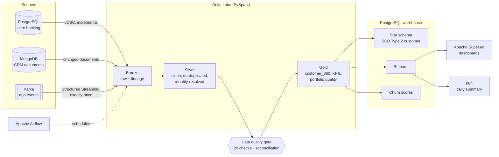

# Customer 360 Lakehouse

**One trusted view of every customer, built from three very different source systems.**

A bank's customer data is scattered: balances and loans sit in a relational core banking
database, service history sits in a document-based CRM, and digital behaviour arrives as a
stream of mobile-app events. This project unifies all three into a single source of truth,
validates it, models it for reporting, and uses it to flag customers likely to leave.

It runs end to end on a laptop with one command, on realistic synthetic data.


---

## Architecture



| Layer | What happens | Why it matters |
| --- | --- | --- |
| **Sources** | PostgreSQL (core banking: customers, accounts, loans, 280k+ transactions), MongoDB (4.5k nested CRM documents with messy identifiers), Kafka (420k+ app events with duplicates and late arrivals) | Mirrors the real mix of relational, document and streaming data |
| **Bronze** | Raw data landed in Delta Lake with `_source`, `_batch_id`, `_ingested_at` | Immutable history; any downstream table can be rebuilt |
| **Silver** | Typed, standardised (phones to E.164), de-duplicated with Delta `MERGE`, CRM records resolved to customers | One clean record per real-world entity |
| **Quality gate** | 20 checks: uniqueness, nulls, valid values, ranges, source-to-lake row-count reconciliation | Bad data stops the pipeline before it reaches a report |
| **Gold** | `customer_360` (one row per customer), `kpi_daily`, `portfolio_quality` | Business-ready, documented tables |
| **Warehouse** | Star schema with SCD Type 2 customer history, point-in-time surrogate keys, idempotent reloads; wide marts for BI | Fast, consistent reporting with full history |
| **ML** | Churn propensity model trained on point-in-time features | Turns the 360 view into action: who to call this week |
| **Orchestration** | Airflow DAG with retries and quality gates; n8n sends the daily summary | Runs unattended, fails loudly |

---

## Quick start

Requirements: Docker Desktop with **8 GB+ memory** allocated, and `make`.

```bash
git clone https://github.com/Jamrahc/customer360-lakehouse.git
cd customer360-lakehouse

make up          # PostgreSQL, MongoDB, Kafka + the pipeline image
make generate    # synthetic data into all three sources (~1 min)
make run         # bronze -> silver -> checks -> gold -> warehouse -> churn model (~3-4 min)
make psql        # explore the warehouse: SELECT * FROM dwh.mart_customer_360 LIMIT 10;
```

Optional services:

```bash
make up-all      # adds Airflow (localhost:8080), n8n (localhost:5678), Superset (localhost:8088)
```

* **Airflow**: the `customer360_daily` DAG runs at 06:00 Dhaka time. The admin password is
  printed in the container log (`docker compose logs airflow | grep -i password`).
* **n8n**: import `n8n/daily_report_workflow.json`, add a PostgreSQL credential
  (host `postgres`, database `c360`, user `bi_reader`) and activate it.
* **Superset**: log in with `admin` / `admin`; the warehouse is already connected
  through a read-only role. See [docs/dashboards.md](docs/dashboards.md) for the charts.

See history tracking in action:

```bash
make changes     # 2% of customers move district or get re-rated for KYC risk
make run         # the warehouse keeps both versions (SCD Type 2)
```

---

## Results from a full run

3,000 customers, 120 days of history, on a 2-core machine:

| Step | Output | Time |
| --- | --- | --- |
| Bronze | 3,000 customers · 5,999 accounts · 1,260 loans · 283,815 transactions · 4,508 CRM documents · 421,107 events | 33 s |
| Silver | 4,077 duplicate app events removed; 97.9% of CRM records resolved to a customer (67% by ID, 20% by phone, 10% by e-mail) | 40 s |
| Quality gate | 20 of 20 checks passed, including exact row-count reconciliation with the source | 19 s |
| Gold | `customer_360` 3,000 rows · `kpi_daily` 121 days · `portfolio_quality` 25 segments | 18 s |
| Warehouse | 240,543 daily transaction facts · 63,889 engagement facts · 1,260 loan snapshots | 54 s |
| Churn model | ROC-AUC **0.91**, PR-AUC 0.75, top-decile precision 81% (**5.7x lift** over the 14% base rate) | 15 s |

A second run with no new source data adds **zero** rows anywhere (incremental and idempotent).
After `make changes`, 58 customers gain a second version in `dim_customer` with correct
`valid_from` / `valid_to` dates.

> The data is synthetic, generated with built-in behavioural patterns (falling activity and more
> complaints before a customer leaves), so the model scores are higher than you would expect on
> real data. The point is the pipeline, not the AUC.

---

## Design decisions

**Medallion layers on Delta Lake.** Bronze is append-only and keeps every batch, so silver and
gold can be rebuilt at any time, and an auditor can see exactly what the source sent.

**Three ingestion patterns, chosen per source.**
* *Reference tables* (customers, accounts, loans): full daily snapshot, because they are small
  and change in place.
* *Transactions*: incremental by timestamp watermark, because they are large and append-only.
  At bank scale this would become change data capture (Debezium) or partitioned JDBC reads.
* *App events*: Spark Structured Streaming from Kafka with a checkpoint, triggered as
  `availableNow`. Checkpointed offsets plus Delta's transaction log give exactly-once delivery
  into bronze, even if the job crashes halfway.

**Schema-on-read for CRM.** CRM documents are stored as raw JSON strings in bronze and parsed
with an explicit schema in silver, so a new CRM field never breaks ingestion.

**Identity resolution.** CRM records carry a customer ID, a phone number in one of four formats,
or an e-mail in random case. Silver normalises phones to E.164 and e-mails to lower case, then
matches in order of reliability: ID, phone, e-mail. Unmatched records are kept and flagged, and
are re-resolved on the next run.

**Duplicates and late data.** Retried app events are removed with `MERGE ... WHEN NOT MATCHED
INSERT` on `event_id`, so re-processing a batch never double-counts. Late events are accepted
and their delay is recorded (`arrival_delay_min`), because a late transfer is still a transfer.

**Quality gates with distinct exit codes.** A failed `error` check raises and the CLI exits with
code `3`. The shell wrapper and Airflow do not retry exit code 3: a retry can fix a network
blip, never bad data.

**SCD Type 2 with point-in-time keys.** When a customer's segment, district or KYC risk changes,
the old row is closed and a new one opened. Facts join to the version that was valid on the
fact's date, so last quarter's report still shows last quarter's segment.

**Idempotent loads.** Facts for the rolling window are deleted and re-inserted inside one
transaction: reruns give identical results, and dashboard users never see a half-loaded table.

**Point-in-time ML features.** The model is trained on features computed as of 30 days before the
run date, labelled with what happened in the following 30 days. Training on today's features
would leak the outcome into the inputs.

**Least privilege.** Superset and n8n read through a `bi_reader` role with `SELECT` only.

---

## At production scale

What would change for hundreds of millions of rows a day:

| Concern | This project | At scale |
| --- | --- | --- |
| Compute | Spark `local[*]` | Spark on Kubernetes, EMR or Databricks, autoscaling |
| Storage | Local Delta tables | Delta / Iceberg on object storage (S3, ADLS), partitioned by date |
| Source extraction | JDBC + watermark | CDC with Debezium into Kafka; partitioned reads |
| Streaming | `availableNow` micro-batch | Continuous streaming with watermarks and windowed aggregates |
| Table maintenance | n/a | `OPTIMIZE`, Z-ordering, `VACUUM`, small-file compaction |
| Warehouse | PostgreSQL | Columnar MPP warehouse; incremental `MERGE` instead of reloads |
| Quality | Custom checks | Great Expectations or dbt tests, with alerting and data contracts |
| Governance | Read-only BI role | Catalog with lineage (Unity Catalog / DataHub), PII masking, row-level security |
| Secrets | `.env` | Vault or a cloud secrets manager |

---

## Project structure

```
src/c360/
  generate/        synthetic sources: core banking, CRM documents, app events
  ingest/          bronze: JDBC snapshots + watermark, MongoDB, Kafka streaming
  transform/       silver (clean, MERGE, identity resolution) and gold (360, KPIs)
  quality/         data quality checks and source reconciliation
  warehouse/       star schema DDL, SCD Type 2 merge, idempotent loads
  ml/              churn model: point-in-time training, scoring
dags/              Airflow DAG
n8n/               report distribution workflow
scripts/           run_pipeline.sh (locking, retries, exit codes), healthcheck.sh
superset/          Superset bootstrap
tests/             unit tests (Spark) + SCD Type 2 integration test (PostgreSQL)
```

## Testing

```bash
make test        # 13 tests: generators, transformations, quality checks, SCD Type 2
make lint
```

CI runs lint, the full test suite against a PostgreSQL service, and shell syntax checks on every push.

---

*All data in this repository is synthetic. No real customer, bank or personal data is used.*
